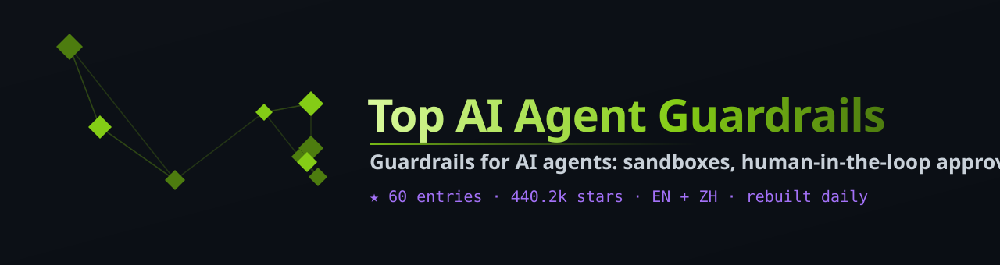

# Top AI Agent Guardrails

<i>Guardrails for AI agents: sandboxes, human-in-the-loop approval, cost and budget limits, prompt-injection defenses and runtime policy checks, ranked by GitHub stars</i>

  

  

**English** · [简体中文](README.zh-CN.md)

---

## Contents

- [🏆 Top Picks](#top-picks)
- [Guardrail Frameworks & Policy Engines](#sec-1) · 15
- [Agent Sandboxes](#sec-2) · 15
- [Human Approval & Cost Limits](#sec-3) · 15
- [Prompt Injection & Runtime Security](#sec-4) · 15
- [📖 About this list](#about)

## 🏆 Top Picks

| # | Project | ⭐ Stars | Language | Updated | Description |
|:-:|:--|--:|:-:|:-:|:--|
| 1 | [**cheaper-inference/OmniRoute**](https://github.com/cheaper-inference/OmniRoute) | 80.5k | TypeScript | 2026-10-24 | Never stop coding. Free MIT AI gateway: one endpoint, 375 providers (150+ free), 1,400+ models Kimi, Claude,… |
| 2 | [**BerriAI/litellm**](https://github.com/BerriAI/litellm) | 61.9k | Python | 2026-10-24 | The fastest, litest AI Gateway. Rust core with Python SDK. Call 100+ LLM APIs in OpenAI (or native) format wi… |
| 3 | [**ifixai-ai/iFixAi**](https://github.com/ifixai-ai/iFixAi) | 33.9k | Python | 2026-10-23 | Independent Auditing of AI Agents. Run by human or the agent itself, to answer the most crucial question in t… |
| 4 | [**wasmerio/wasmer**](https://github.com/wasmerio/wasmer) | 21.2k | Rust | 2026-10-23 | 🚀 Fast and lightweight sandboxes for your apps and AI agents |
| 5 | [**NVIDIA/SkillSpector**](https://github.com/NVIDIA/SkillSpector) | 21.1k | Python | 2026-10-23 | Security scanner for AI agent skills. Detect vulnerabilities, malicious patterns, security risks, prompt inje… |

## Guardrail Frameworks & Policy Engines

| # | Project | ⭐ Stars | Language | Updated | Description |
|:-:|:--|--:|:-:|:-:|:--|
| 1 | [**BerriAI/litellm**](https://github.com/BerriAI/litellm) | 61.9k | Python | 2026-10-24 | The fastest, litest AI Gateway. Rust core with Python SDK. Call 100+ LLM APIs in OpenAI (or native) format wi… |
| 2 | [**Portkey-AI/gateway**](https://github.com/Portkey-AI/gateway) | 13.3k | TypeScript | 2026-05-25 | A blazing fast AI Gateway with integrated guardrails. Route to 1,600+ LLMs, 50+ AI Guardrails with 1 fast & f… |
| 3 | [**data-privacy-stack/presidio**](https://github.com/data-privacy-stack/presidio) | 11.5k | Python | 2026-10-19 | An open-source framework for detecting, redacting, masking, and anonymizing sensitive data (PII) across text,… |
| 4 | [**maximhq/bifrost**](https://github.com/maximhq/bifrost) | 9.1k | Go | 2026-10-24 | Open-source, high-performance AI gateway that works as your LLM gateway, MCP gateway and agent gateway. One O… |
| 5 | [**NVIDIA-NeMo/Guardrails**](https://github.com/NVIDIA-NeMo/Guardrails) | 7.4k | Python | 2026-10-24 | NeMo Guardrails is an open-source toolkit for easily adding programmable guardrails to LLM-based conversation… |
| 6 | [**katanemo/plano**](https://github.com/katanemo/plano) | 7.1k | Rust | 2026-10-07 | Plano is an AI-native proxy server and data plane for agentic apps. Smart LLM routing, observability, agent o… |
| 7 | [**superagent-ai/superagent**](https://github.com/superagent-ai/superagent) | 6.8k | TypeScript | 2026-08-25 | Superagent protects your AI applications against prompt injections, data leaks, and harmful outputs. Embed sa… |
| 8 | [**FailproofAI/failproofai**](https://github.com/FailproofAI/failproofai) | 6.1k | TypeScript | 2026-10-24 | Observability and enforcement for AI agent harnesses. Capture every run and runtime reliability with policy e… |
| 9 | [**lennney/stop-that-shit**](https://github.com/lennney/stop-that-shit) | 3.1k | JavaScript | 2026-10-24 | Chinese-language project; see the repo for details |
| 10 | [**confident-ai/deepteam**](https://github.com/confident-ai/deepteam) | 3.0k | Python | 2026-10-23 | DeepTeam is a framework to red team LLMs and AI agents. |

Show 5 more

| # | Project | ⭐ Stars | Language | Updated | Description |
|:-:|:--|--:|:-:|:-:|:--|
| 11 | [**msoedov/agentic_security**](https://github.com/msoedov/agentic_security) | 2.0k | Python | 2026-10-19 | Agentic LLM Vulnerability Scanner / AI red teaming kit 🧪 |
| 12 | [**kenryu42/cc-safety-net**](https://github.com/kenryu42/cc-safety-net) | 1.8k | TypeScript | 2026-10-24 | A pre-execution guard for AI coding agents. It blocks destructive Git and file system commands, plus common a… |
| 13 | [**archestra-ai/OpenAPPA**](https://github.com/archestra-ai/OpenAPPA) | 1.6k | Rust | 2026-10-23 | Deterministic guardrails that don't break agents |
| 14 | [**akto-api-security/akto**](https://github.com/akto-api-security/akto) | 1.5k | Java | 2026-10-23 | Akto is the fastest growing AI Security platform for your teams to secure AI agents, MCPs, LLMs, Agent skills… |
| 15 | [**hoophq/hoop**](https://github.com/hoophq/hoop) | 836 | Go | 2026-10-24 | Open-source enforcement at runtime that masks sensitive data and blocks destructive commands from AI agents.… |

## Agent Sandboxes

| # | Project | ⭐ Stars | Language | Updated | Description |
|:-:|:--|--:|:-:|:-:|:--|
| 1 | [**wasmerio/wasmer**](https://github.com/wasmerio/wasmer) | 21.2k | Rust | 2026-10-23 | 🚀 Fast and lightweight sandboxes for your apps and AI agents |
| 2 | [**opensandbox-group/OpenSandbox**](https://github.com/opensandbox-group/OpenSandbox) | 16.1k | Python | 2026-10-24 | Secure, Fast, and Extensible Sandbox runtime for AI agents. |
| 3 | [**TencentCloud/CubeSandbox**](https://github.com/TencentCloud/CubeSandbox) | 13.0k | Go | 2026-10-23 | Instant, Concurrent, Secure & Lightweight Sandbox for AI Agents. |
| 4 | [**mattpocock/sandcastle**](https://github.com/mattpocock/sandcastle) | 8.6k | TypeScript | 2026-10-20 | Orchestrate sandboxed coding agents in TypeScript with sandcastle.run() |
| 5 | [**withastro/flue**](https://github.com/withastro/flue) | 8.5k | TypeScript | 2026-10-17 | The sandbox agent framework. |
| 6 | [**smol-machines/smolvm**](https://github.com/smol-machines/smolvm) | 6.8k | Rust | 2026-10-24 | An embeddable, portable, branchable virtual machine to safely run Agents locally. |
| 7 | [**microsoft/agent-governance-toolkit**](https://github.com/microsoft/agent-governance-toolkit) | 6.5k | Python | 2026-10-23 | AI Agent Governance Toolkit — Policy enforcement, zero-trust identity, execution sandboxing, and reliability… |
| 8 | [**agent-infra/sandbox**](https://github.com/agent-infra/sandbox) | 6.2k | Python | 2026-09-14 | All-in-One Sandbox for AI Agents that combines Browser, Shell, File, MCP and VSCode Server in a single Docker… |
| 9 | [**rivet-dev/agentos**](https://github.com/rivet-dev/agentos) | 4.8k | Rust | 2026-10-23 | Tiny, fast, Linux-compatible sandboxes. Powered by WebAssembly. |
| 10 | [**nolabs-ai/nono**](https://github.com/nolabs-ai/nono) | 4.7k | Rust | 2026-10-23 | agent runtime security - zero trust, zero setup, zero latency agent sandboxing |

Show 5 more

| # | Project | ⭐ Stars | Language | Updated | Description |
|:-:|:--|--:|:-:|:-:|:--|
| 11 | [**kubernetes-sigs/agent-sandbox**](https://github.com/kubernetes-sigs/agent-sandbox) | 4.4k | Go | 2026-10-24 | agent-sandbox enables easy management of isolated, stateful, singleton workloads, ideal for use cases like AI… |
| 12 | [**arcboxlabs/arcbox**](https://github.com/arcboxlabs/arcbox) | 4.2k | Rust | 2026-10-22 | Run AI agents on real and isolated machines — own kernel, filesystem, and network — with <100ms boot. Local f… |
| 13 | [**onecli/onecli**](https://github.com/onecli/onecli) | 3.6k | TypeScript | 2026-10-22 | Open-source sandboxed agent harness for teams. Giving every employee a secured personal agent. |
| 14 | [**deeplethe/forkd**](https://github.com/deeplethe/forkd) | 2.9k | Rust | 2026-10-24 | Fork() for AI agent microVMs. Spawn 100 children in ~100ms from a warm parent; BRANCH a live VM in ~150ms. KV… |
| 15 | [**zerobootdev/zeroboot**](https://github.com/zerobootdev/zeroboot) | 2.5k | Rust | 2026-10-18 | Sub-millisecond VM sandboxes for AI agents via copy-on-write forking |

## Human Approval & Cost Limits

| # | Project | ⭐ Stars | Language | Updated | Description |
|:-:|:--|--:|:-:|:-:|:--|
| 1 | [**cheaper-inference/OmniRoute**](https://github.com/cheaper-inference/OmniRoute) | 80.5k | TypeScript | 2026-10-24 | Never stop coding. Free MIT AI gateway: one endpoint, 375 providers (150+ free), 1,400+ models Kimi, Claude,… |
| 2 | [**humanlayer/humanlayer**](https://github.com/humanlayer/humanlayer) | 12.1k | TypeScript | 2026-10-24 | The best way to get AI coding agents to solve hard problems in complex codebases. |
| 3 | [**ThinkWatchProject/ThinkWatch**](https://github.com/ThinkWatchProject/ThinkWatch) | 818 | Rust | 2026-10-24 | Self-hosted AI API and MCP gateway for organizations: SSO and RBAC, per-user identity for MCP tool calls, PII… |
| 4 | [**NadirRouter/NadirClaw**](https://github.com/NadirRouter/NadirClaw) | 661 | Python | 2026-10-22 | Source-available LLM router and AI cost optimizer. Routes simple prompts to cheap or local models and complex… |
| 5 | [**apache/casbin-gateway**](https://github.com/apache/casbin-gateway) | 643 | Go | 2026-10-22 | See what every AI coding agent on your machine is doing, and whether the API behind it is the one you paid fo… |
| 6 | [**Justin0504/Aegis**](https://github.com/Justin0504/Aegis) | 523 | TypeScript | 2026-10-09 | Runtime policy enforcement for AI agents. Cryptographic audit trail, human-in-the-loop approvals, kill switch… |
| 7 | [**cordum-io/cordum**](https://github.com/cordum-io/cordum) | 511 | Go | 2026-10-21 | The action firewall for AI agents. Enforce policy and human approval before risky tool calls, shell commands,… |
| 8 | [**clawvisor/clawvisor**](https://github.com/clawvisor/clawvisor) | 283 | Go | 2026-10-21 | API gateway for purpose-based authorization for AI agents. Human approval for tasks, AI-native enforcement fo… |
| 9 | [**ferro-labs/ai-gateway**](https://github.com/ferro-labs/ai-gateway) | 270 | Go | 2026-10-19 | Unified AI Gateway for 30+ LLMs (OpenAI, Anthropic, Bedrock, Azure etc) with Caching, Guardrails, A/B test &… |
| 10 | [**MaxInGaussian/pi-plans**](https://github.com/MaxInGaussian/pi-plans) | 239 | TypeScript | 2026-10-11 | Human-in-the-loop planning extension for the Pi coding agent. Turns rough change requests into versioned Mark… |

Show 5 more

| # | Project | ⭐ Stars | Language | Updated | Description |
|:-:|:--|--:|:-:|:-:|:--|
| 11 | [**edwinkys/phantasm**](https://github.com/edwinkys/phantasm) | 197 | Svelte | 2024-11-28 | Toolkits to create a human-in-the-loop approval layer to monitor and guide AI agents workflow in real-time. |
| 12 | [**decionis/docker**](https://github.com/decionis/docker) | 165 | Go | 2026-08-25 | Govern consequential AI agent actions in Docker with deterministic policy, human approval, and signed Decisio… |
| 13 | [**spring-ai-community/spring-ai-playground**](https://github.com/spring-ai-community/spring-ai-playground) | 145 | Java | 2026-09-22 | Safe local execution layer for AI agent tools. Build and test-run MCP tools (no pass, no run), serve them fro… |
| 14 | [**BrightbeamAI/chap**](https://github.com/BrightbeamAI/chap) | 121 | HTML | 2026-10-22 | CHAP, the Collaborative Human Agent Protocol, is a MCP/A2A-compatible runtime for auditable human-agent work:… |
| 15 | [**escapeboy/agent-fleet-o**](https://github.com/escapeboy/agent-fleet-o) | 76 | PHP | 2026-10-20 | Open-source AI agent orchestration platform — self-hosted mission control for autonomous multi-agent systems.… |

## Prompt Injection & Runtime Security

| # | Project | ⭐ Stars | Language | Updated | Description |
|:-:|:--|--:|:-:|:-:|:--|
| 1 | [**ifixai-ai/iFixAi**](https://github.com/ifixai-ai/iFixAi) | 33.9k | Python | 2026-10-23 | Independent Auditing of AI Agents. Run by human or the agent itself, to answer the most crucial question in t… |
| 2 | [**NVIDIA/SkillSpector**](https://github.com/NVIDIA/SkillSpector) | 21.1k | Python | 2026-10-23 | Security scanner for AI agent skills. Detect vulnerabilities, malicious patterns, security risks, prompt inje… |
| 3 | [**NVIDIA/garak**](https://github.com/NVIDIA/garak) | 9.7k | Python | 2026-10-23 | the LLM vulnerability scanner |
| 4 | [**Tencent/AI-Infra-Guard**](https://github.com/Tencent/AI-Infra-Guard) | 7.1k | Python | 2026-10-22 | A full-stack AI Red Teaming platform securing AI ecosystems via Agent Scan, Skills Scan, MCP scan, AI Infra s… |
| 5 | [**Giskard-AI/giskard-oss**](https://github.com/Giskard-AI/giskard-oss) | 5.9k | Python | 2026-10-24 | 🐢 Open-Source Evaluation & Testing library for LLM Agents |
| 6 | [**stacklok/toolhive**](https://github.com/stacklok/toolhive) | 2.3k | Go | 2026-10-24 | ToolHive is an enterprise-grade platform for running and managing Model Context Protocol (MCP) servers. |
| 7 | [**uber/ADR**](https://github.com/uber/ADR) | 2.1k | Python | 2026-10-24 | ADR secures enterprise AI agents through observability, security benchmarking, and threat detection. Deployed… |
| 8 | [**cyberark/FuzzyAI**](https://github.com/cyberark/FuzzyAI) | 1.6k | Jupyter Notebook | 2026-02-06 | A powerful tool for automated LLM fuzzing. It is designed to help developers and security researchers identif… |
| 9 | [**OWASP/www-project-top-10-for-large-language-model-applicati…**](https://github.com/OWASP/www-project-top-10-for-large-language-model-applications) | 1.5k | Python | 2026-08-05 | OWASP Top 10 for Large Language Model Apps (Part of the GenAI Security Project) |
| 10 | [**tophant-ai/aibeat**](https://github.com/tophant-ai/aibeat) | 1.4k | HTML | 2026-10-21 | Break your AI before they do. Join Discord: https://discord.gg/NXXz8JG74 |

Show 5 more

| # | Project | ⭐ Stars | Language | Updated | Description |
|:-:|:--|--:|:-:|:-:|:--|
| 11 | [**utkusen/promptmap**](https://github.com/utkusen/promptmap) | 1.3k | Python | 2025-12-01 | a security scanner for custom LLM applications |
| 12 | [**ZeroDayEvil/ai-security-tool**](https://github.com/ZeroDayEvil/ai-security-tool) | 1.1k | HTML | 2026-10-21 | 🛡️ Free open-source AI-powered security terminal & vulnerability scanner (CVE, SBOM). Supports SSH, SFTP, RDP… |
| 13 | [**splx-ai/agentic-radar**](https://github.com/splx-ai/agentic-radar) | 1.1k | Python | 2025-11-27 | A security scanner for your LLM agentic workflows |
| 14 | [**Pantheon-Security/medusa**](https://github.com/Pantheon-Security/medusa) | 1.0k | Python | 2026-08-10 | AI-first security scanner. NEW in v2026.7: Claude Code compromise detection — vet .claude/ hooks, permissions… |
| 15 | [**whylabs/langkit**](https://github.com/whylabs/langkit) | 1.0k | Jupyter Notebook | 2024-11-22 | 🔍 LangKit: An open-source toolkit for monitoring Large Language Models (LLMs). 📚 Extracts signals from prompt… |

## 📖 About this list

This list is collected from GitHub, deduplicated, link-checked and ranked by stars (recency breaks ties). It is regenerated automatically on a schedule, so numbers stay fresh.

---

Auto-generated · refreshed on a schedule · ranked by GitHub stars · 2026-10-24

